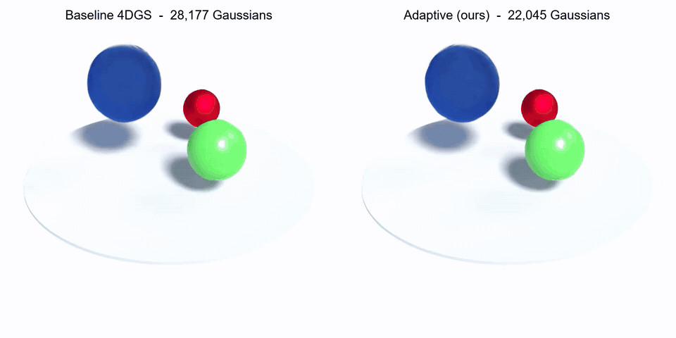

# Complexity-Aware Adaptive Density for 4D Gaussian Splatting

A modification of the densification and pruning step in [4D Gaussian Splatting](https://github.com/hustvl/4DGaussians) (Wu et al., CVPR 2024) that spends Gaussians where the scene is hard to reconstruct and removes them where it is not.

On the D-NeRF `bouncingballs` scene it trains a model with **22% fewer Gaussians** in **11% less time**, with test PSNR on par with the baseline (+0.23 dB in a single run).

This repository is a fork. The 4DGS model, renderer and training pipeline are the original authors' work; my contribution is the density manager and its integration, listed under [What is mine](#what-is-mine).



Novel-view renders of the final models, baseline on the left and adaptive on the right. Full-quality video: [`assets/bouncingballs_comparison.mp4`](assets/bouncingballs_comparison.mp4).

## Problem

4DGS grows its set of Gaussians with one rule applied everywhere: clone or split any Gaussian whose view-space position gradient passes a fixed threshold. Pruning is only switched on once a scene exceeds 200,000 Gaussians, so on small scenes nothing is ever removed. The result is a model that carries many Gaussians that contribute little, and every one of them costs time on each training and rendering step.

## Method

At every densification step (every 100 iterations, from iteration 500 to 15,000), each Gaussian gets a complexity score: its accumulated view-space position gradient, normalised by the current maximum. Gaussians are then ranked into three groups by quartile, and each group is treated differently.

| Group | Share | Densification | Pruning |
|---|---|---|---|
| High complexity | top 25% | threshold lowered to 0.7x, so these split more readily | opacity only |
| Medium | middle 50% | standard threshold | opacity only |
| Low complexity | bottom 25% | never densified | opacity, plus removed if larger than 10% of the scene extent (after iteration 1,000) |

Opacity pruning (opacity below 0.005) is applied at every densification step rather than only above 200,000 Gaussians.

The manager also saves a plot of the complexity scores and groups every 1,000 iterations to `<model_path>/adaptive_density_viz/`.

## Results

D-NeRF `bouncingballs`, 20,000 iterations (3,000 coarse), config `arguments/dnerf/bouncingballs.py`, RTX 4050 Laptop GPU (6 GB).

| | Baseline | Adaptive | Change |
|---|---|---|---|
| Gaussians (final) | 28,177 | 22,045 | -21.8% |
| Training time, fine stage | 17 min 31 s | 15 min 38 s | -10.8% |
| Training time, whole run | 18 min 31 s | 16 min 21 s | -11.7% |
| Test PSNR at 20,000 iterations | 40.34 dB | 40.57 dB | +0.23 dB |
| Test PSNR at 14,000 iterations | 39.93 dB | 40.05 dB | +0.12 dB |
| Train PSNR at 20,000 iterations | 46.07 dB | 46.05 dB | -0.02 dB |

Gaussian counts are read from the saved `point_cloud.ply` files, times and PSNR from each run's `train.log`. The two runs were made back to back on the same machine.

### Limits of these results

- One scene, one run per method. Three separate baseline runs gave 39.82 to 39.93 dB at iteration 14,000, so the PSNR difference is of the same order as run-to-run variation and should be read as "no loss", not as a gain.
- PSNR is the training script's own evaluation, which uses a subset of the test views. SSIM and LPIPS have not been computed.
- The method changes two things at once: it turns on frequent opacity pruning, and it makes densification depend on complexity. There is no ablation yet showing how much of the reduction each one accounts for.
- The adaptive run's time includes writing a diagnostic plot every 1,000 iterations.

## What is mine

| File | |
|---|---|
| `adaptive_density_integration.py` | `AdaptiveDensityManager`: complexity scoring, the densify and prune masks, and the visualisations. |
| `adaptive_train.py` | The training script with the manager wired into the densification step. |
| `baseline_train.py` | The upstream `train.py` under a separate name for comparison. The only change is an added evaluation at iteration 20,000. |

`train.py` is the unmodified upstream script.

## Setup

Requires an NVIDIA GPU with CUDA.

```bash
git clone https://github.com/eunoryx/4DGaussians
cd 4DGaussians

# The two CUDA extensions are not included in this fork; fetch them separately.
git clone --recursive https://github.com/ingra14m/depth-diff-gaussian-rasterization submodules/depth-diff-gaussian-rasterization
git clone https://gitlab.inria.fr/bkerbl/simple-knn.git submodules/simple-knn

conda create -n Gaussians4D python=3.9
conda activate Gaussians4D
pip install -r requirements.txt
pip install -e submodules/depth-diff-gaussian-rasterization
pip install -e submodules/simple-knn
```

`requirements.txt` pins the upstream versions (PyTorch 1.13.1, CUDA 11.6). The results above were produced with Python 3.9 and PyTorch 2.5.1 with CUDA 12.1.

### Data

Download the D-NeRF synthetic dataset from [Dropbox](https://www.dropbox.com/s/0bf6fl0ye2vz3vr/data.zip?dl=0) and extract it so that the scenes sit under `data/dnerf/`:

```
data/dnerf/bouncingballs/
data/dnerf/mutant/
...
```

## Running

Train the baseline and the adaptive method (about 18 and 16 minutes on the GPU above):

```bash
python baseline_train.py -s data/dnerf/bouncingballs --port 6021 --expname "baseline/bouncingballs" --configs arguments/dnerf/bouncingballs.py
python adaptive_train.py -s data/dnerf/bouncingballs --port 6017 --expname "adaptive/bouncingballs" --configs arguments/dnerf/bouncingballs.py
```

Render the test views and a novel-view video for each. The output is written to `<model_path>/test/` and `<model_path>/video/`, each with a `video_rgb.mp4`:

```bash
python render.py --model_path output/baseline/bouncingballs --skip_train --configs arguments/dnerf/bouncingballs.py
python render.py --model_path output/adaptive/bouncingballs --skip_train --configs arguments/dnerf/bouncingballs.py
```

Compute PSNR, SSIM and LPIPS on the rendered test views:

```bash
python metrics.py --model_paths output/baseline/bouncingballs output/adaptive/bouncingballs
```

## Credit

Built on [4D Gaussian Splatting for Real-Time Dynamic Scene Rendering](https://github.com/hustvl/4DGaussians) by Wu, Yi, Fang, Xie, Zhang, Wei, Liu, Tian and Wang, which in turn builds on [3D Gaussian Splatting](https://github.com/graphdeco-inria/gaussian-splatting). See the upstream repository for the full documentation of the base method, the other datasets and the viewer. The licence in `LICENSE.md` is theirs and applies to this fork.

```
@InProceedings{Wu_2024_CVPR,
    author    = {Wu, Guanjun and Yi, Taoran and Fang, Jiemin and Xie, Lingxi and Zhang, Xiaopeng and Wei, Wei and Liu, Wenyu and Tian, Qi and Wang, Xinggang},
    title     = {4D Gaussian Splatting for Real-Time Dynamic Scene Rendering},
    booktitle = {Proceedings of the IEEE/CVF Conference on Computer Vision and Pattern Recognition (CVPR)},
    month     = {June},
    year      = {2024},
    pages     = {20310-20320}
}
```
